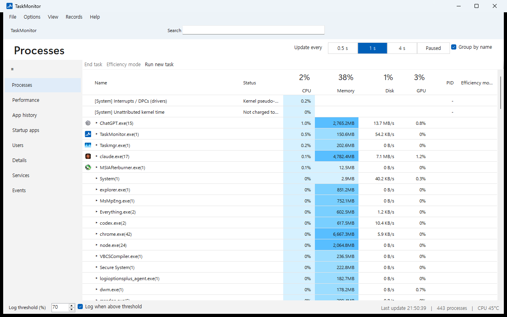
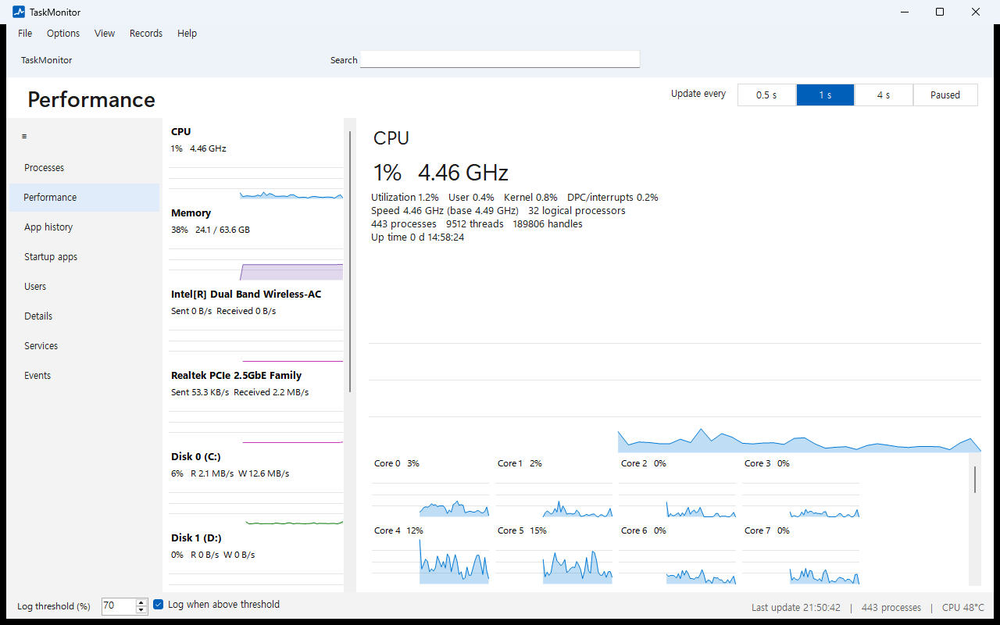
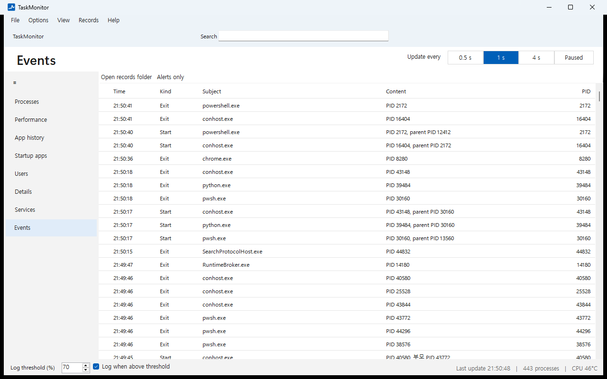

# TaskMonitor

[한국어](README.md) | **English**

TaskMonitor is a Windows task manager built to answer one question: *what is using my CPU, and why?* It shows the CPU time that the built-in Task Manager hides (interrupts, DPCs, kernel time not charged to any process), records every process start and exit, warns about overheating and runaway processes, and writes a cause report for the last hour. Everything stays on your PC.

## Download

Get `TaskMonitor.exe` from [Releases](https://github.com/minia1234/TaskManager/releases/latest). It is a single exe. It needs no installer and no .NET install.

## How it differs from Task Manager

- **Hidden CPU time.** The `[System] Interrupts / DPCs` and `[System] Unattributed kernel time` rows show CPU use that no process row accounts for.
- **A record you can look back on.** Spikes are recorded even when the window is closed. Process starts and exits, alerts, and game sessions build up on the Events page and in record files. When TaskMonitor sits in the tray, a new alert shows a Windows notification.
- **Cause report.** Compares the last hour with the hour before: resource averages and peaks, alerts, the programs started most often, and cumulative use by app, in one document. You can also pick two periods to compare.
- **Network and FPS per process.** TCP/UDP throughput and frame rate (FPS) per process, without administrator rights.
- **Hardware health.** NVIDIA GPU temperature, hot spot, memory junction, power and clock limit reasons, and disk health (temperature, life left, SMART). CPU temperature too, while MSI Afterburner or HWiNFO runs.
- **Safe process actions.** End task, priority and efficiency mode check the target's creation time first, so a reused PID never ends the wrong program.
- **Korean and English.** Switch under Options > Language. The first run follows the Windows display language.

## Screens

**Performance.** Graphs and details for CPU (per core), memory, disks, network adapters and GPUs.

**Events.** Process starts and exits, alerts and game sessions. "Alerts only" filters to alerts. Records from before today show their date.

The other pages:

- **Processes.** Programs with the same name group as `name(count)` and expand. The large numbers in the header are total CPU, memory, and the busiest disk and GPU. The status column shows "Not responding" and "Suspended". The View menu switches to a parent-child tree. Choose columns adds connection count, network and FPS (the Network column is on by default where network measurement works). Right-click for end task, end process tree, suspend, efficiency mode, priority, affinity, dump file, the analysis window, Check on VirusTotal, Exclude from alerts and more. The explorer.exe row can restart Windows Explorer.
- **Performance > Network.** Under the adapter values, the five programs using the most network.
- **App history.** Cumulative CPU time and I/O transferred (file, network and pipe) per program.
- **Startup apps.** Run registry entries plus Task Scheduler tasks that run at logon or boot (Windows' own tasks left out).
- **Users, Details, Services.** The same roles as in Task Manager. Right-click a service to change its startup type (Automatic, Manual, Disabled). Stopping, restarting or disabling a service asks first.
- **Records menu.** Cause report, compare records, records timeline (alerts and game sessions marked over CPU, memory and GPU graphs), export to CSV, open the records folder.
- **View menu.** Programs blocking sleep (`powercfg /requests`, needs administrator rights) and an always-on-top mini window.

Alert limits are below. Right-click > Exclude from alerts turns off the per-process alerts for a program.

- GPU 85°C, GPU memory junction 100°C, disk 70°C, CPU 95°C, memory 90%, total CPU 90% for 20 s
- One process over 50% of total CPU for 20 s
- One process using 10 MB/s or more of network (sent plus received) for 30 s, or uploading 2 MB/s or more for 30 s
- A window not responding for over 15 s
- One process's memory (private bytes) growing by over 500 MB in 30 minutes without ever shrinking (possible leak)

Keyboard shortcuts: Ctrl+Shift+Alt+T (bring up TaskMonitor from anywhere), Ctrl+F (search), Ctrl+1 to 8 (pages), Delete (end the selected task), Ctrl+N (run new task), F5 (refresh).

## Install and run

1. Put `TaskMonitor.exe` in any folder.
2. Run it. If Windows shows "Windows protected your PC", choose "More info" and then "Run anyway" (the build is not code-signed yet).
3. For background recording, turn on **Options > Start with Windows** and **Options > Close button hides to tray**. TaskMonitor then starts as a tray icon with no window.
4. To see per-process network and SATA disk SMART, turn on **Options > Always run as administrator (no UAC prompt)**. UAC asks once when you turn it on. After that TaskMonitor opens as administrator with no prompt from a shortcut, Start with Windows or Ctrl+Shift+Esc. It registers a Task Scheduler task set to run with highest privileges (`TaskMonitor Elevated <user name>`).
   - This option and Task Manager replacement below run the exe with high privileges. Any program that can write to the exe's folder could replace it and gain the same privileges, so a folder only administrators can write to (such as `C:\Program Files\TaskMonitor`) is safer. In that folder, get updates from the Releases page instead of automatically.
5. To use it instead of Windows Task Manager, turn on **Options > Open TaskMonitor with Ctrl+Shift+Esc (replace Task Manager)** (UAC asks once). Ctrl+Shift+Esc, Task Manager on the taskbar and the Ctrl+Alt+Del screen then open TaskMonitor. Turn it off to go back to Windows Task Manager. If you move the exe to another folder, the next start asks whether to switch to the new location. An exe on a network or removable drive can't be used. The setting applies to every user of the PC, so if the exe sits in a folder other users can't read (such as your user folder), Task Manager won't open for them.

When a new version comes out, TaskMonitor downloads it, checks it against the SHA-256 published on GitHub, and puts it in place. Choose "restart now" at the right of the menu bar, or it takes effect on the next start. If the exe sits in a folder it cannot write to, such as Program Files, choose "Get version" to download it from the Releases page.

Only one copy runs at a time. Starting it again brings the open window to the front.

## Requirements

Windows 11 x64 (tested) or Windows 10 x64 (supported, not yet tested). No administrator rights needed. Some values have conditions.

| Feature | Condition |
|---|---|
| Network and FPS per process | The account is in the `Performance Log Users` group, or TaskMonitor runs as administrator. Otherwise the status bar says so and the values show "-". |
| SMART for SATA and USB disks | Administrator rights (File > Run as administrator). NVMe works without them. |
| CPU temperature | MSI Afterburner running with "CPU temperature" enabled in its monitoring list, or HWiNFO running with "Shared Memory Support" on. Windows gives no CPU temperature without a driver, so TaskMonitor reads the value these tools already read. |
| Motherboard fan speed | HWiNFO running with "Shared Memory Support" on. |
| GPU details | NVIDIA driver (NVML). AMD GPUs are beta. |

## Privacy and records

TaskMonitor contacts only GitHub (api.github.com, and the release file on github.com when a new version exists) to check for updates. It sends no usage records. It checks at startup and once a day; turn off **Options > Automatic updates** to stop it. Only when you choose "Check on VirusTotal" does it open the VirusTotal page for the executable's SHA-256 in your browser. The file itself is never uploaded. All records live in `%LOCALAPPDATA%\TaskMonitor`.

| File | Contents |
|---|---|
| `activity-log.jsonl` | Process starts and exits (name, PID), alerts, game sessions. Rolls over to `.1` every 10 MB. |
| `resource-log.jsonl` | CPU, memory and GPU utilization, GPU temperature and VRAM every 5 s. Rolls over every 20 MB. |
| `app-history.json` | Cumulative CPU time and I/O per executable path. |
| `spike-log.csv` | The top 5 processes whenever total CPU passes the threshold (70% by default). |
| `settings.json` | Settings. |
| `crash.log`, `freeze.log` | Unexpected errors and hangs. Please attach these when reporting a problem. |

**Records > Open records folder** opens the folder. To remove the app, choose **File > Uninstall TaskMonitor...**. It turns off Task Manager replacement, running as administrator and Start with Windows, then deletes the exe. The records folder stays, so delete it yourself if you don't need it. If you only delete the exe, a restore task (`TaskMonitor Restore Task Manager`) puts Windows Task Manager back at the next boot or logon and then deletes itself. Until then Ctrl+Shift+Esc opens nothing.

## Known limits

- A process that starts and exits between two samples (1 s by default) is not recorded.
- A game session is inferred as "a full-screen window using 30% or more GPU 3D for over 10 s". TaskMonitor does not check that it is really a game.
- FPS is measured only for programs that present through DXGI.

## Development

Building, making the release exe and the self-test are covered in [docs/DEVELOPING.md](docs/DEVELOPING.md) (Korean). Open-source components are listed in [THIRD-PARTY-NOTICES.txt](THIRD-PARTY-NOTICES.txt).
