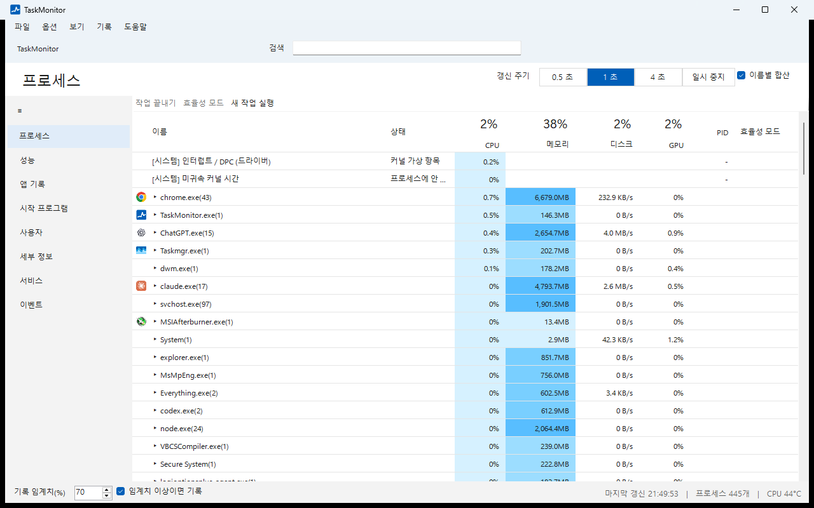
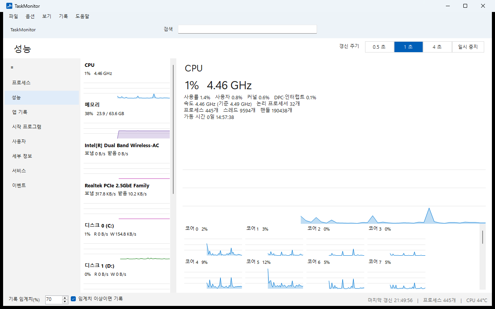
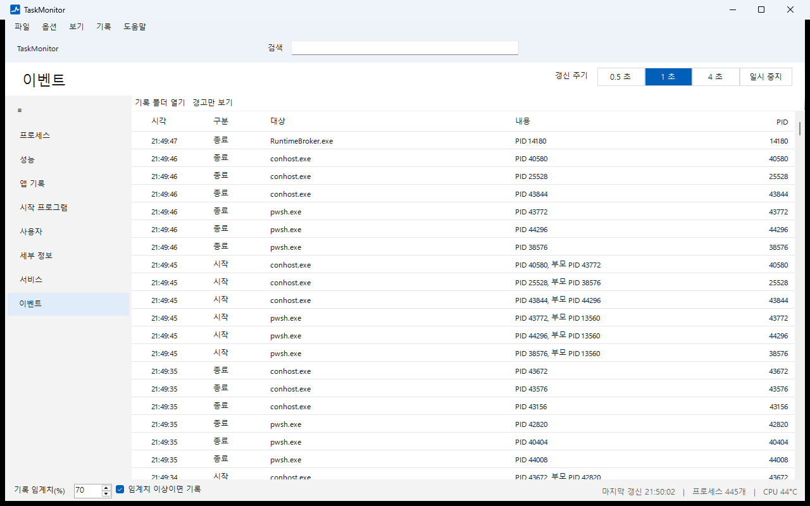

# TaskMonitor

**한국어** | [English](README.en.md)

TaskMonitor는 "CPU를 누가, 왜 쓰는가"를 찾는 Windows 작업 관리자입니다. 기본 작업 관리자가 보여 주지 않는 CPU 시간(인터럽트, DPC, 어느 프로세스에도 잡히지 않는 커널 시간)을 보여 주고, 프로세스 시작·종료를 모두 기록하고, 과열과 폭주하는 프로세스를 경고하고, 최근 1시간의 원인 분석 리포트를 만듭니다. 모든 기록은 이 PC에만 남습니다.

## 내려받기

[Releases](https://github.com/minia1234/TaskManager/releases/latest)에서 `TaskMonitor.exe`를 받습니다. 설치 프로그램이나 .NET 설치 없이 exe 하나로 실행됩니다.

## 기본 작업 관리자와 다른 점

- **보이지 않던 CPU 시간.** `[시스템] 인터럽트 / DPC`와 `[시스템] 미귀속 커널 시간` 행이 프로세스 목록에 안 잡히는 CPU 사용을 따로 보여 줍니다.
- **지난 일을 되짚는 기록.** 창을 보고 있지 않을 때 생긴 스파이크도 남습니다. 프로세스 시작·종료, 경고, 게임 세션이 이벤트 페이지와 기록 파일에 쌓입니다. 트레이에 숨어 있을 때 새 경고가 생기면 Windows 알림으로 알려 줍니다.
- **원인 분석 리포트.** 최근 1시간을 그 전 1시간과 비교해 자원 평균·최고, 경고, 자주 시작된 프로그램, 앱별 누적 사용량을 한 문서로 정리합니다. 두 기간을 직접 골라 비교할 수도 있습니다.
- **프로세스별 네트워크와 FPS.** 관리자 권한 없이 프로세스별 TCP·UDP 전송 속도와 화면 프레임 수(FPS)를 봅니다.
- **하드웨어 상태.** NVIDIA GPU의 온도·핫스팟·메모리 접합부·전력·클럭 제한 이유와 디스크 건강(온도, 남은 수명, SMART)을 봅니다. MSI Afterburner나 HWiNFO가 실행 중이면 CPU 온도도 봅니다.
- **안전한 프로세스 작업.** 끝내기·우선 순위·효율 모드는 대상의 생성 시각을 확인한 뒤 실행합니다. PID가 다른 프로그램에 재사용된 경우 엉뚱한 프로그램을 끄지 않습니다.
- **한국어와 영어.** 옵션 > 언어에서 바꿉니다. 처음 실행할 때는 Windows 표시 언어를 따릅니다.

## 화면

**성능.** CPU(코어별), 메모리, 디스크, 네트워크, GPU 그래프와 상세 값입니다.

**이벤트.** 프로세스 시작·종료, 경고, 게임 세션입니다. "경고만 보기"로 경고만 걸러 봅니다. 오늘이 아닌 기록에는 날짜가 붙습니다.

그 밖의 페이지는 다음과 같습니다.

- **프로세스.** 같은 이름은 `이름(개수)`로 묶여 펼쳐 볼 수 있습니다. 머리글의 큰 숫자는 전체 CPU, 메모리, 가장 바쁜 디스크와 GPU의 사용률입니다. 보기 메뉴에서 부모-자식 트리로 볼 수 있고, 열 선택에서 연결 수, 네트워크, FPS 열을 켤 수 있습니다. 우클릭하면 끝내기, 작업 트리 끝내기, 효율 모드, 우선 순위, 선호도, 덤프 파일, 분석 창 등을 씁니다.
- **앱 기록.** 프로그램별 누적 CPU 시간과 I/O 전송량(파일·네트워크·파이프 포함)입니다.
- **시작 프로그램, 사용자, 세부 정보, 서비스.** 기본 작업 관리자와 같은 역할입니다. 서비스 중지와 다시 시작은 확인 창을 거칩니다.
- **기록 메뉴.** 원인 분석 리포트, 기록 비교, CSV 내보내기, 기록 폴더 열기입니다.

경고 기준은 GPU 85°C, GPU 메모리 접합부 100°C, 디스크 70°C, CPU 95°C, 메모리 90%, 전체 CPU 90% 20초 지속, 한 프로세스가 전체 CPU 50% 이상 20초 지속입니다.

## 설치와 실행

1. `TaskMonitor.exe`를 원하는 폴더에 둡니다.
2. 실행합니다. Windows가 "Windows의 PC 보호" 창을 띄우면 "추가 정보"를 누른 뒤 "실행"을 누릅니다(코드 서명 전 빌드라서 나옵니다).
3. 백그라운드 기록을 원하면 **옵션 > Windows 시작 시 실행**과 **옵션 > 닫기 단추로 트레이에 숨기기**를 켭니다. 시작할 때 창 없이 트레이 아이콘으로 실행됩니다.

새 버전이 나오면 TaskMonitor가 받아 GitHub에 올라온 SHA-256 값과 맞는지 확인한 뒤 바꿔 둡니다. 메뉴 줄 오른쪽의 "지금 다시 시작"을 누르거나 다음에 실행할 때 새 버전이 됩니다. Program Files처럼 쓸 수 없는 폴더에 두었다면 "받기"를 눌러 Release 페이지에서 직접 받습니다.

한 번에 하나만 실행됩니다. 이미 떠 있으면 두 번째 실행은 그 창을 앞으로 불러옵니다.

## 요구 사항

Windows 11 x64(확인함), Windows 10 x64(지원 대상, 확인 전). 관리자 권한은 필요 없습니다. 일부 값은 조건이 있습니다.

| 기능 | 조건 |
|---|---|
| 프로세스별 네트워크, FPS | 계정이 `Performance Log Users` 그룹에 속하거나 관리자 권한으로 실행. 조건이 안 맞으면 상태 바에 안내가 나오고 값은 "-"입니다. |
| SATA·USB 디스크의 SMART | 관리자 권한(파일 > 관리자 권한으로 다시 실행). NVMe는 권한 없이 읽습니다. |
| CPU 온도 | MSI Afterburner 실행 중이고 모니터링 항목에서 "CPU temperature"가 켜져 있음, 또는 HWiNFO 실행 중이고 "Shared Memory Support" 켬. Windows는 드라이버 없이 CPU 온도를 내주지 않아서 이 도구들이 읽은 값을 빌려 씁니다. |
| 메인보드 팬 속도 | HWiNFO 실행 중, "Shared Memory Support" 켬. |
| GPU 상세 | NVIDIA 드라이버(NVML). AMD GPU는 베타 지원입니다. |

## 개인 정보와 기록

TaskMonitor는 새 버전 확인을 위해 GitHub(api.github.com, 새 버전이 있을 때 github.com의 Release 파일)에만 접속하고, 사용 기록은 보내지 않습니다. 확인은 시작할 때와 하루 한 번이며, **옵션 > 자동 업데이트**를 끄면 접속하지 않습니다. 기록은 모두 `%LOCALAPPDATA%\TaskMonitor`에 있습니다.

| 파일 | 내용 |
|---|---|
| `activity-log.jsonl` | 프로세스 시작·종료(이름, PID), 경고, 게임 세션. 10MB마다 `.1`로 밀어냅니다. |
| `resource-log.jsonl` | 5초마다 CPU·메모리·GPU 사용률, GPU 온도, VRAM. 20MB마다 밀어냅니다. |
| `app-history.json` | 실행 파일 경로별 누적 CPU 시간과 I/O 전송량. |
| `spike-log.csv` | 전체 CPU가 임계치(기본 70%)를 넘을 때 상위 5개 프로세스. |
| `settings.json` | 설정. |
| `crash.log`, `freeze.log` | 예기치 않은 오류와 멈춤 기록. 문제를 알릴 때 이 파일을 보내 주세요. |

**기록 > 기록 폴더 열기**로 폴더를 열 수 있습니다. 앱을 지우려면 `TaskMonitor.exe`와 이 폴더를 지우고, 시작 프로그램에 등록했다면 먼저 옵션에서 끄세요.

## 알아 둘 한계

- 샘플링 주기(기본 1초) 사이에 시작하고 끝난 짧은 프로세스는 기록되지 않습니다.
- 게임 세션은 "전체 화면 창이 GPU 3D를 30% 이상 10초 넘게 쓴 경우"로 추정하며, 실제 게임인지는 확인하지 않습니다.
- FPS는 DXGI로 화면을 그리는 프로그램만 잽니다.

## 개발

빌드, 배포용 exe 만들기, 자체 검증은 [docs/DEVELOPING.md](docs/DEVELOPING.md)에 있습니다. 사용하는 오픈 소스 구성 요소는 [THIRD-PARTY-NOTICES.txt](THIRD-PARTY-NOTICES.txt)에 있습니다.
